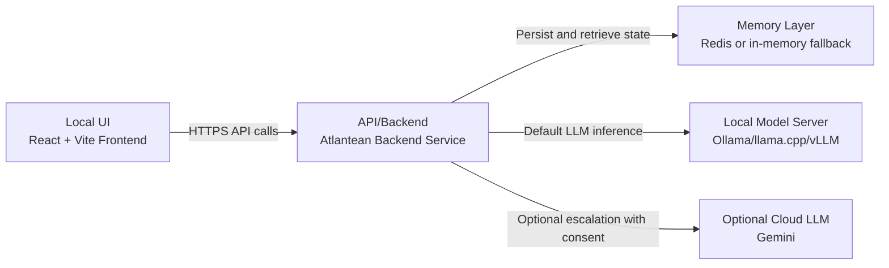

> **License: None — Proprietary. © 2026 Axiom Zeta Innovations LLC. All rights reserved.** This repository is source-visible only. No license is granted to copy, modify, distribute, or use this software except under a paid subscription governed by [EULA.md](EULA.md). Viewing this code grants no rights.

<div align="center">

</div>

# Run your AI Studio app locally

This contains everything you need to run your app locally.

View your app in AI Studio: https://ai.studio/apps/drive/12CDszUJAxwc5CBTjwFTX8IKXHZUgE5LY

## Project Focus

This repository is configured for local development and execution.

## Architecture Diagram



## Run Locally

**Prerequisites:**  Node.js


1. Install dependencies:
   `npm install`
2. Configure [.env.local](.env.local) for local-first inference:
   - `ATLANTEAN_LLM_PROVIDER=local`
   - `LOCAL_LLM_BACKEND=ollama`
   - `LOCAL_LLM_URL=http://127.0.0.1:11434/api/generate`
   - `LOCAL_LLM_MODEL=llama3.1:8b-instruct-q4_K_M`
   - `ALLOW_OUTBOUND_NETWORK=0`
   - `ALLOW_CLOUD_ESCALATION=0`
3. Start your local model server (example with Ollama):
   `ollama serve`
4. Run the app:
   `npm run dev`

Optional cloud escalation:
- Set `ALLOW_CLOUD_ESCALATION=1`
- Set `REQUIRE_CLOUD_ESCALATION_CONSENT=1`
- Set `GEMINI_API_KEY=...`
- Have the client send `cloud_escalation_consent=true` for the specific request

Local backend adapter options:
- Ollama: `LOCAL_LLM_BACKEND=ollama`, `LOCAL_LLM_URL=http://127.0.0.1:11434/api/generate`
- llama.cpp server: `LOCAL_LLM_BACKEND=llama.cpp`, `LOCAL_LLM_URL=http://127.0.0.1:8080/completion`
- vLLM OpenAI-compatible completions: `LOCAL_LLM_BACKEND=vllm`, `LOCAL_LLM_URL=http://127.0.0.1:8000/v1/completions`

Runtime routing controls:
- Open Operator Profile and use Model Routing to choose Local, Gemini, or Mock.
- Cloud escalation consent is stored per device profile and still requires backend policy enablement.

### At-Rest Encryption (Cold Memory)

Cold-memory Redis artifacts (`item:*`, `vector:*`, `manifest:*`) support encryption at rest with key rotation.

Set in `.env.local`:
- `ATLANTEAN_ENCRYPTION_ENABLED=1`
- `ATLANTEAN_ENCRYPTION_KEYS_JSON={"v1":"<fernet-key>","v2":"<fernet-key>"}`
- `ATLANTEAN_ENCRYPTION_ACTIVE_KEY_ID=v2`

Rotation model:
- Keep old keys in `ATLANTEAN_ENCRYPTION_KEYS_JSON` for decrypt compatibility.
- Move `ATLANTEAN_ENCRYPTION_ACTIVE_KEY_ID` to the new key for new writes.
- Remove retired keys only after migration/retention windows are complete.

### Encrypted Sync Package Export (Step 14)

Device sync package exports/imports are passphrase-encrypted via envelope encryption in the frontend.

Properties:
- KDF: PBKDF2-SHA256
- Cipher: AES-GCM-256
- Per-export random salt + IV
- Decryption requires the operator passphrase at import time

Behavior:
- Export prompts for a passphrase and writes only encrypted payloads.
- Import detects encrypted package envelopes and prompts for decryption passphrase.
- Legacy plaintext packages remain import-compatible.

### Ledger Verification On Restore/Merge (Step 15)

Signed event-ledger verification is enforced as a gate during:
- Snapshot restore
- Sync package merge

Controls:
- `ATLANTEAN_VERIFY_LEDGER_ON_RESTORE=1`
- `ATLANTEAN_VERIFY_LEDGER_ON_SYNC_MERGE=1`

If hash-chain/signature verification fails, restore/merge is rejected before mutation.

### Tamper-Evidence For Snapshot Restore And Replay (Step 16)

Additional tamper checks now cover:
- Snapshot restore payload integrity (`snapshot_sha256` verification)
- Replay head consistency (`replay_head_hash` must match stored head hash)

Control:
- `ATLANTEAN_VERIFY_SNAPSHOT_TAMPER_EVIDENCE=1`

If a snapshot payload hash mismatch is detected, restore is rejected with a conflict response before state mutation.

### Corruption Recovery For Partial Snapshot/Ledger Failures (Step 17)

Recovery endpoint:
- `POST /api/atlantean/recovery/repair`

Behavior:
- Prunes snapshot index entries with missing/tampered payloads.
- Deletes orphaned snapshot payload keys for pruned records.
- Repairs ledger head-hash and sequence metadata from decoded event log tail.

Control:
- `ATLANTEAN_ENABLE_CORRUPTION_RECOVERY_REPAIR=1`

### Retention Controls For Memory Classes (Step 18)

Retention controls now apply to:
- Chat memory (`chat_turn` cold-memory items)
- Simulation memory (`simulation` cold-memory items)
- Telemetry memory (bounded `telemetry_log:*` streams)

Controls:
- `ATLANTEAN_ENABLE_MEMORY_RETENTION_CONTROLS=1`
- `ATLANTEAN_RETENTION_CHAT_TURNS_MAX=400`
- `ATLANTEAN_RETENTION_SIMULATIONS_MAX=200`
- `ATLANTEAN_RETENTION_TELEMETRY_EVENTS_MAX=2000`

Operational endpoint:
- `POST /api/atlantean/retention/apply` (manual retention sweep for current session)

### Provider Capability Registry (Step 19)

Provider routing now uses a capability registry instead of hard-coded provider assumptions.

Each provider record exposes:
- `context_window`
- `supports_streaming`
- `supports_tool_calls`

Endpoint:
- `GET /api/atlantean/providers/capabilities`

Optional query parameter:
- `provider` (returns normalized resolution and fallback behavior)

Control:
- `ATLANTEAN_LOCAL_CONTEXT_WINDOW=8192`

### Capability-Bound Orchestration Strategy (Step 20)

Query orchestration now binds to capability-derived strategy IDs instead of provider-name branching.

Execution paths:
- `local_direct`
- `cloud_escalated`
- `cloud_policy_blocked`
- `mock_fallback`

The selected strategy is returned in generation metadata as `orchestration_strategy`.

### Multi-Cycle Reasoning Budgets By Query Class (Step 21)

Symbolic reasoning cycles are now budgeted per query class:
- `simple`
- `analytical`
- `deep`
- `file_assisted`

Controls:
- `ATLANTEAN_ENABLE_QUERY_CLASS_REASONING_BUDGETS=1`
- `ATLANTEAN_REASONING_CYCLES_SIMPLE=0`
- `ATLANTEAN_REASONING_CYCLES_ANALYTICAL=1`
- `ATLANTEAN_REASONING_CYCLES_DEEP=2`
- `ATLANTEAN_REASONING_CYCLES_FILE_ASSISTED=2`

The selected query class and cycle execution summary are returned as `reasoning_budget` metadata in query responses.

### Query Lifecycle Telemetry Triggers (Step 22)

Query lifecycle telemetry now emits symbolic/governance trigger events for:
- `query_lifecycle_start`
- `query_lifecycle_symbolic_cycle_trigger`
- `query_lifecycle_reasoning_summary`
- `query_lifecycle_complete`

Per-cycle trigger payloads include run/block reason, estimated/elapsed compute, and governance snapshot metadata when available.

### HRM/RCM Compute Budget Allocator (Step 23)

A per-request `HRMComputeAllocator` gates each HRM/RCM symbolic pass against:
- Per-query caps (ms) with per-query-class multipliers (deep queries get a larger cap than simple ones).
- Per-window (60-second rolling) caps shared per pass type.

Allocation decisions and elapsed compute are emitted as `hrm_compute_budget_allocation` telemetry. Budget state is returned in the `hrm_compute_budget` field of query responses.

### Dynamic Model Tier Selection (Step 24)

A `ModelTierSelector` picks the local model to invoke based on two signals:
- **Query class**: simple→light, analytical→standard, deep/file_assisted→heavy.
- **Resource pressure**: when the HRM window compute ratio exceeds the threshold (default 0.8), the tier is downgraded one step.

Tier model IDs are configured via `ATLANTEAN_MODEL_TIER_LIGHT/STANDARD/HEAVY`; all default to `LOCAL_LLM_MODEL` for single-model deployments. The `model_tier_selected` telemetry event and `model_tier` response field expose the decision.

### Runtime Routing Controls in Profile/Settings (Step 25)

The Operator Profile modal now includes a **Routing Controls** section exposing:
- **Model Tier Preference**: auto / light / standard / heavy — overrides the query-class mapping when set.
- **Local Backend**: auto / ollama / llama.cpp / vLLM — forwarded as a hint per query.

Preferences are persisted in `localStorage` and sent with every query. The backend honours the tier preference via the `ModelTierSelector` operator override and exposes the full runtime routing config at `GET /api/atlantean/routing/settings`.

## Validation And Benchmarks

Run the full validation suite:

```bash
python tests/run_validation.py
```

Includes:
- HRM simulation tests
- Hot/cold memory persistence tests
- Sync conflict tests
- Stateless LLM enforcement tests

Run CPU batch training benchmark for HRM:

```bash
python benchmarks/hrm_cpu_batch_benchmark.py --batch-size 16 --steps 100 --epochs 3
```

## QUADRA Symbolic Governance Modules

New modules in `atlantean_core`:
- `symbolic_reasoner.py`
- `governance.py`
- `scheduler.py`

These modules are compute-gated and optional by design. They do not run continuously.

### Compute-Gating Controls

Set environment variables to enable and bound optional symbolic reasoning:

```bash
export QUADRA_SYMBOLIC_ENABLED=1
export QUADRA_SYMBOLIC_EVERY_N_QUERIES=25
export QUADRA_SYMBOLIC_MAX_COMPUTE_MS=6.0
export QUADRA_SYMBOLIC_BUDGET_MS_PER_MIN=120.0
export QUADRA_GOVERNANCE_WINDOW_SECONDS=60
export QUADRA_GOVERNANCE_MAX_INVOCATIONS=32
```

Defaults keep symbolic reasoning disabled unless explicitly enabled.

## Which GUI Is Running

This repo includes two separate UI surfaces:

1. React/Vite app (default for current stack)
   - URL: `http://localhost:5000`
   - Edit files in: `App.tsx`, `components/`, `hooks/`, `services/`
2. Flask demo GUI (separate legacy/demo surface)
   - URL: `http://localhost:5000`
   - Start with: `python gui.py`
   - Edit files in: `gui.py`, `templates/index.html`

If your GUI edits are not reflecting, confirm you are editing the files for the UI running on your active port.

## Security

### CORS Configuration

Both backends restrict cross-origin requests to whitelisted origins. Key points:
- Development: defaults to `localhost` origins; no configuration needed
- Production: set `ALLOWED_ORIGINS=https://your-domain.com` (comma-separated) before starting the backend
- Troubleshooting: check the `ALLOWED_ORIGINS` env var and the `ATLANTEAN_BIND_HOST` setting

### Provider Security

Model credentials and routing are:
- ✅ Stored server-side in `.env.local` (never exposed to browser)
- ✅ Local-first by default (`ATLANTEAN_LLM_PROVIDER=local`)
- ✅ Cloud escalation blocked unless enabled and consented
- ✅ Never injected into frontend builds

All browser requests route through `/api/atlantean/query` backend endpoint.

### Session Security (Production)

Before production start, set:
- `ATLANTEAN_SESSION_SECRET` to a strong random value
- `SESSION_COOKIE_SECURE=1` when running over HTTPS

Example:

```bash
export ATLANTEAN_SESSION_SECRET="$(openssl rand -hex 32)"
export SESSION_COOKIE_SECURE=1
```

